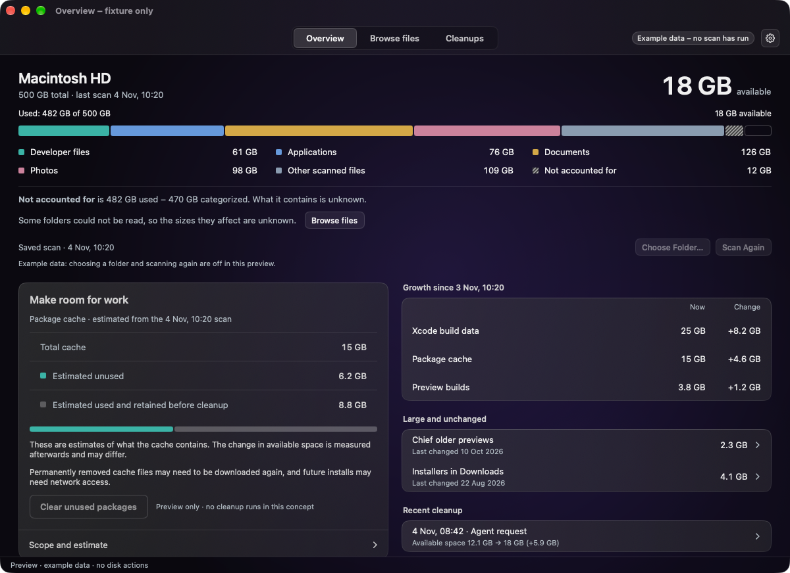
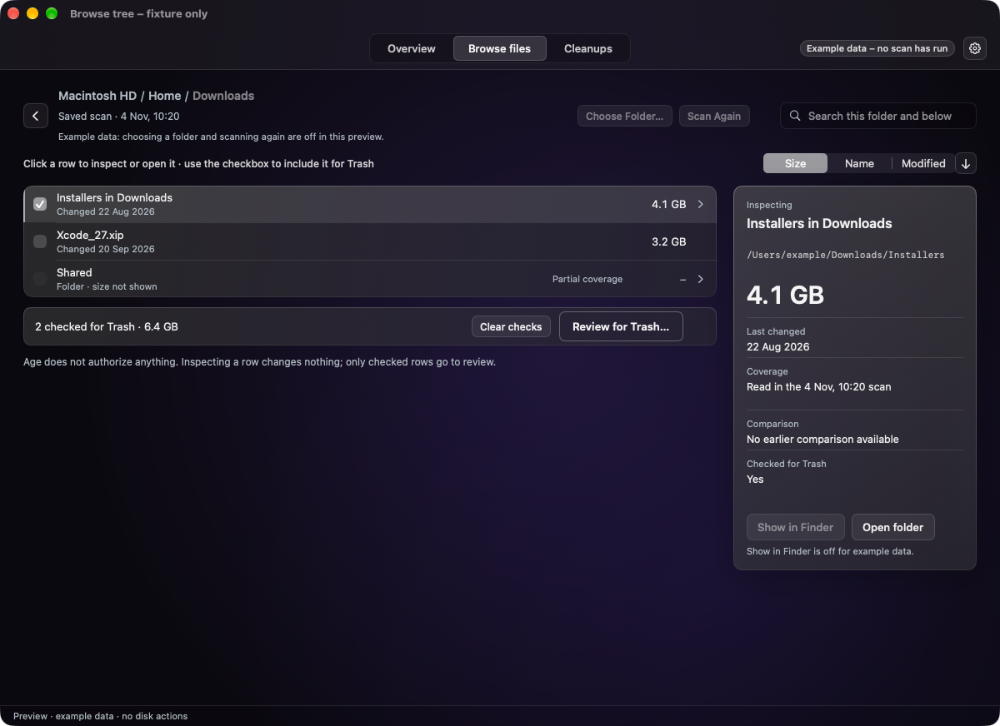
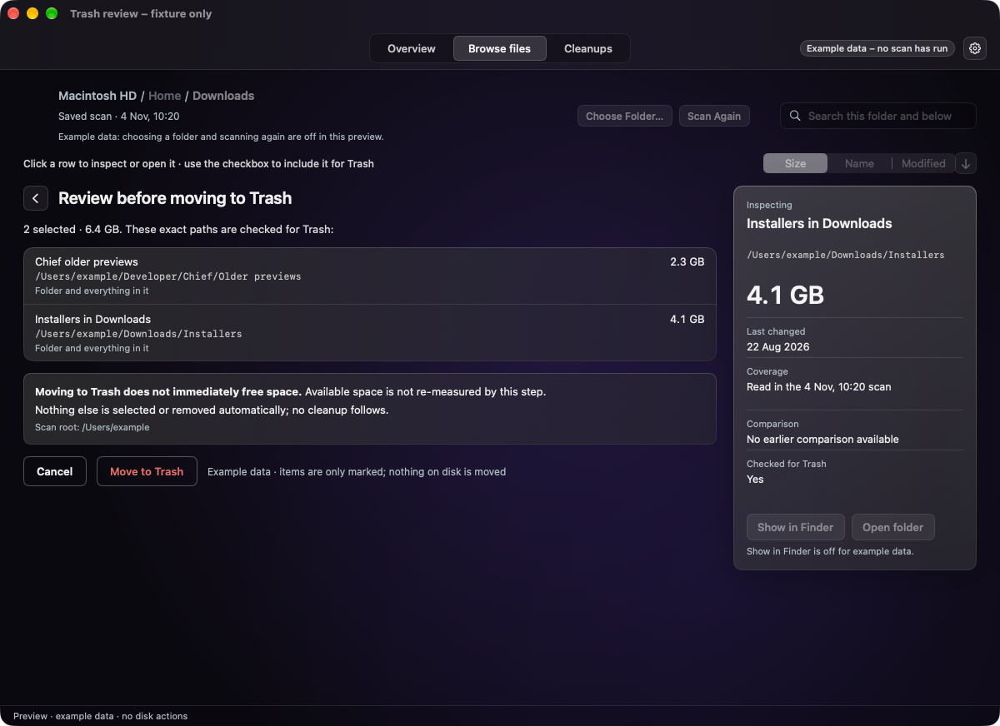
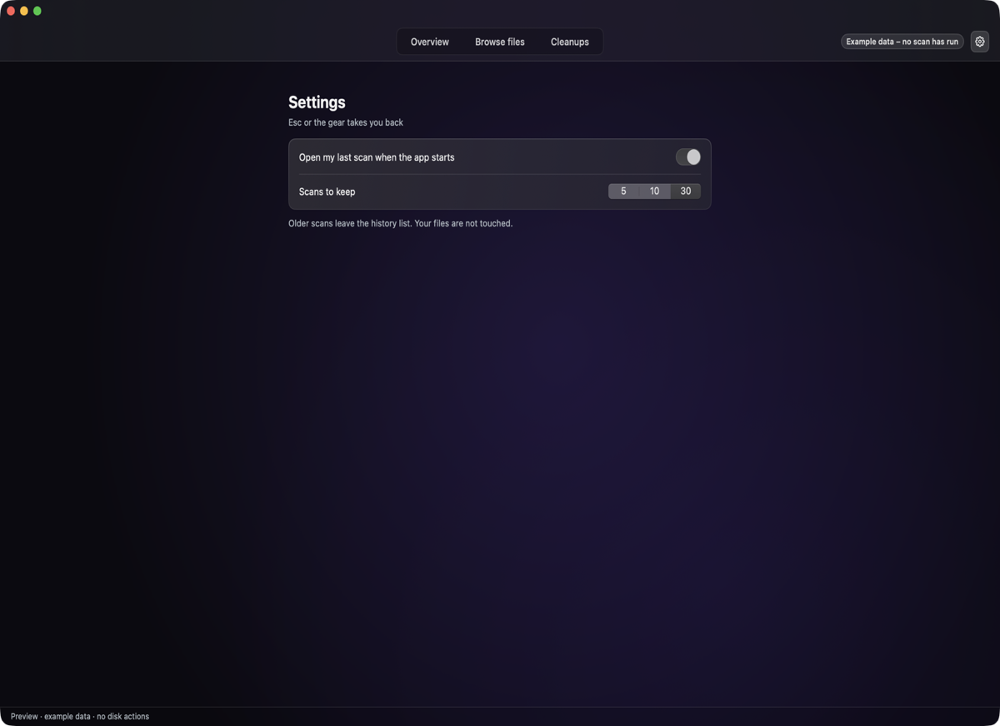

# Disk Cleaner

See what fills your Mac, choose exactly what goes, and give your AI agent an honest answer about free space.

<p align="center">
  
</p>

<p align="center">
  <a href="https://github.com/aikongen/disk-cleaner/actions/workflows/ci.yml"></a>
  <a href="https://github.com/aikongen/disk-cleaner/releases"></a>
  
  
  <a href="LICENSE"></a>
</p>

Most disk tools either draw you a chart or clean "junk" on their own terms. Disk Cleaner shows you what is really there, lets you choose exactly what goes, and tells an AI agent the truth too. It is a personal, local macOS app: your data stays on your Mac.

## What you get

<table>
  <tr>
    <td width="50%" valign="top">
      
      <br><b>See what fills your disk</b>
      <br>Capacity and the sizes of the folder you scanned, side by side. Estimates, sizes and measured changes stay separate, and unknown stays unknown.
      <br>The Make room for work card and the recent cleanup row are a concept preview with example data; no cleanup category is enabled yet, and the real app shows a disabled Clean up button.
    </td>
    <td width="50%" valign="top">
      
      <br><b>Find it without rescanning</b>
      <br>The scan is kept. Click into folders, step back with breadcrumbs, search, and sort by Size, Name or Modified.
    </td>
  </tr>
  <tr>
    <td width="50%" valign="top">
      
      <br><b>Choose exactly, then check</b>
      <br>Check the items you want and read their full paths first. Move to Trash moves those paths and nothing else, with an outcome for each.
    </td>
    <td width="50%" valign="top">
      
      <br><b>Keep it your way</b>
      <br>A Teal or Violet atmosphere, remember the last scan, and keep 5, 10 or 30 scans.
    </td>
  </tr>
</table>

Screenshots show the built-in preview with example data.

**It never deletes anything permanently and never cleans on its own. It moves exactly the items you chose to the Trash.**

## For AI agents

When an agent needs room to work, it asks for a target amount of available space through `disk-cleanerctl`, a same-user command line tool inside the app. It cannot pass paths, commands or rules.

```sh
cli="/path/to/Disk Cleaner.app/Contents/MacOS/disk-cleanerctl"
"$cli" request 24000000000 'my-unique-request-key'   # ask for 24 GB available, get a job id
"$cli" wait '<job-id>'                               # completed, insufficient, failed or interrupted
```

Today Disk Cleaner measures and reports. No cleanup category is enabled, so a request for more than is free answers `insufficient` rather than guessing. The [automation contract](docs/reference/automation-contract.md) lists every command, field and status.

## Install

There is no published release yet. Build from source on macOS 14 or later with Xcode 16 or later (Swift 6). It has been built and tested only on Apple silicon.

```sh
git clone https://github.com/aikongen/disk-cleaner.git
cd disk-cleaner
swift build -c release
swift test
scripts/build-and-package.sh
```

`swift test` uses fixtures in temporary folders only. `scripts/build-and-package.sh` writes two apps to `artifacts/`: `Disk Cleaner.app`, with `disk-cleanerctl` inside, and `Disk Cleaner Preview.app`, example data only. Both are ad-hoc signed, not notarized, so macOS may ask you to confirm the first launch.

Once a release is published, download it with the GitHub CLI so macOS does not quarantine it:

```sh
gh release download vX.Y.Z -R aikongen/disk-cleaner -p 'DiskCleaner-*'
```

### Try it with example data first

The preview shows every screen with example data and cannot touch your disk. Open one screen directly with `--scene`:

```sh
swift run DiskCleanerApp --demo --scene browse
open -n "artifacts/Disk Cleaner Preview.app" --args --scene trash-review
```

Scenes: `overview`, `browse`, `browse-tree`, `empty`, `scanning`, `settings`, `trash-review`, `trash-outcome`, `cleanup-result`.

## Use

1. Open `Disk Cleaner.app` and choose a folder to scan. Cancel keeps your previous result.
2. Read **Overview**: disk capacity beside the folder's recorded sizes.
3. Open **Browse files**. Click a folder row to go inside, use the breadcrumbs or back to return, and search or sort.
4. Tick the items you want, then press **Review for Trash** to read their exact paths. Cancel returns you to the same place with nothing moved.
5. Press **Move to Trash** and read the outcome per item: moved, not moved with the reason, or unknown. Scan again to refresh the numbers.

**Cleanups** lists past agent requests and their outcomes. Settings opens with the gear or Command-comma.

Good to know: space returns only when you empty the Trash, and Finder's Put Back is not promised. The [tutorial](docs/tutorials/first-scan.md) covers the remaining limits and where your data lives.

## Documentation

- [Open Disk Cleaner, scan a folder and review what to move](docs/tutorials/first-scan.md)
- [Automation contract](docs/reference/automation-contract.md)
- [Documentation index](docs/README.md)
- [Changelog](CHANGELOG.md)

## Contribute / Maintain

Build, test and pull request rules are in [CONTRIBUTING.md](CONTRIBUTING.md); fixture isolation, the Xcode project and evidence conventions are in the [maintainer guide](docs/maintainer-guide.md).
Working rules for contributors and agents are in [AGENTS.md](AGENTS.md), and security reports go through [SECURITY.md](SECURITY.md). Disk Cleaner is released under the [MIT License](LICENSE).

<p align="center">
  <a href="https://github.com/aikongen"></a>
</p>
