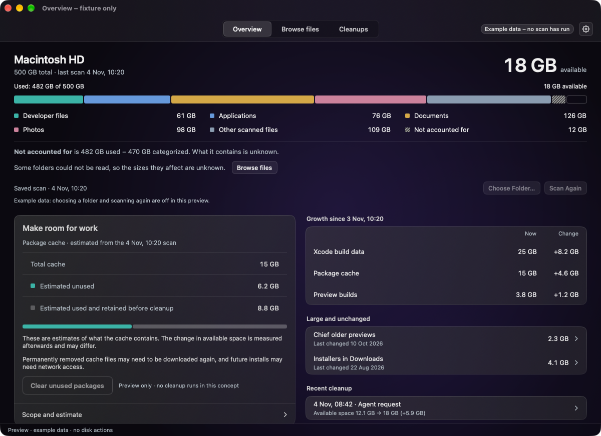
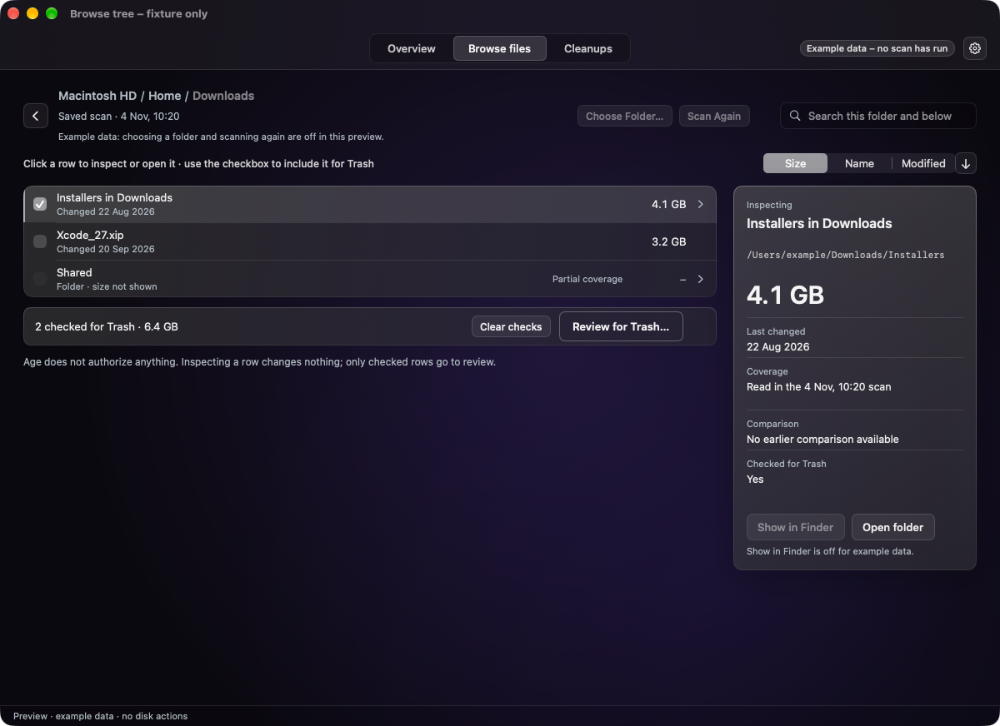
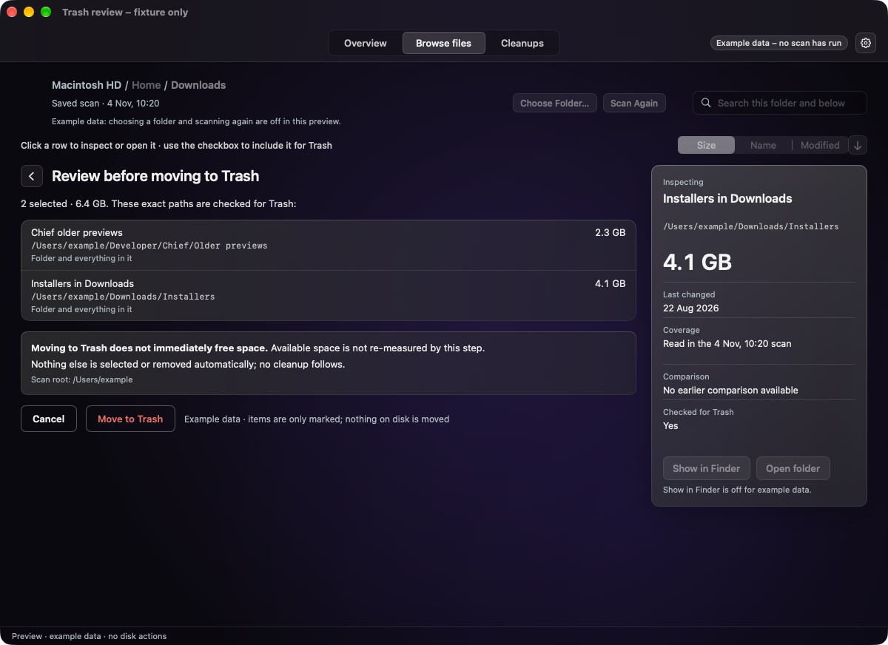
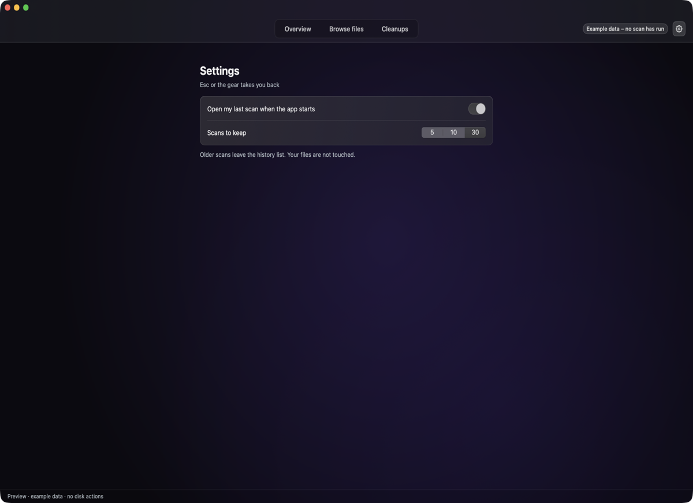

# What Disk Cleaner does

Use this page to see what Disk Cleaner shows you, what it lets you do and what it never does.

See what fills your Mac, choose exactly what goes, and give your AI agent an honest answer about free space. Most disk tools either draw you a chart or clean "junk" on their own terms. Disk Cleaner shows you what is really there, lets you choose exactly what goes, and tells an AI agent the truth too. It is a personal, local macOS app: your data stays on your Mac.

**It never deletes anything permanently and never cleans on its own. It moves exactly the items you chose to the Trash.**

## What you get

- **See what fills your disk.** Capacity and the sizes of the folder you scanned, side by side. Estimates, sizes and measured changes stay separate, and unknown stays unknown.
- **Find it without rescanning.** The scan is kept. Click into folders, step back with breadcrumbs, search, and sort by Size, Name or Modified.
- **Choose exactly, then check.** Check the items you want and read their full paths first. Move to Trash moves those paths and nothing else, with an outcome for each.
- **Keep it your way.** Remember the last scan, and keep 5, 10 or 30 scans.

Screenshots show the built-in preview with example data. The Make room for work card and the recent cleanup row in the Overview are a concept preview with example data; no cleanup category is enabled yet, and the real app shows a disabled Clean up button.

## Use it

1. Open the app and choose a folder to scan. Cancel keeps your previous result.
2. **Overview** shows disk capacity beside the folder's recorded sizes.
3. **Browse files** lets you click into folders, search, sort, and tick the items you want.
4. **Review for Trash** shows their exact paths. **Move to Trash** moves those and nothing else, with an outcome for each.
5. **Cleanups** lists past agent requests and their outcomes. Settings opens with the gear or Command-comma.

Space returns only when you empty the Trash, and Finder's Put Back is not promised. Start with the [first scan tutorial](../tutorials/first-scan.md).
